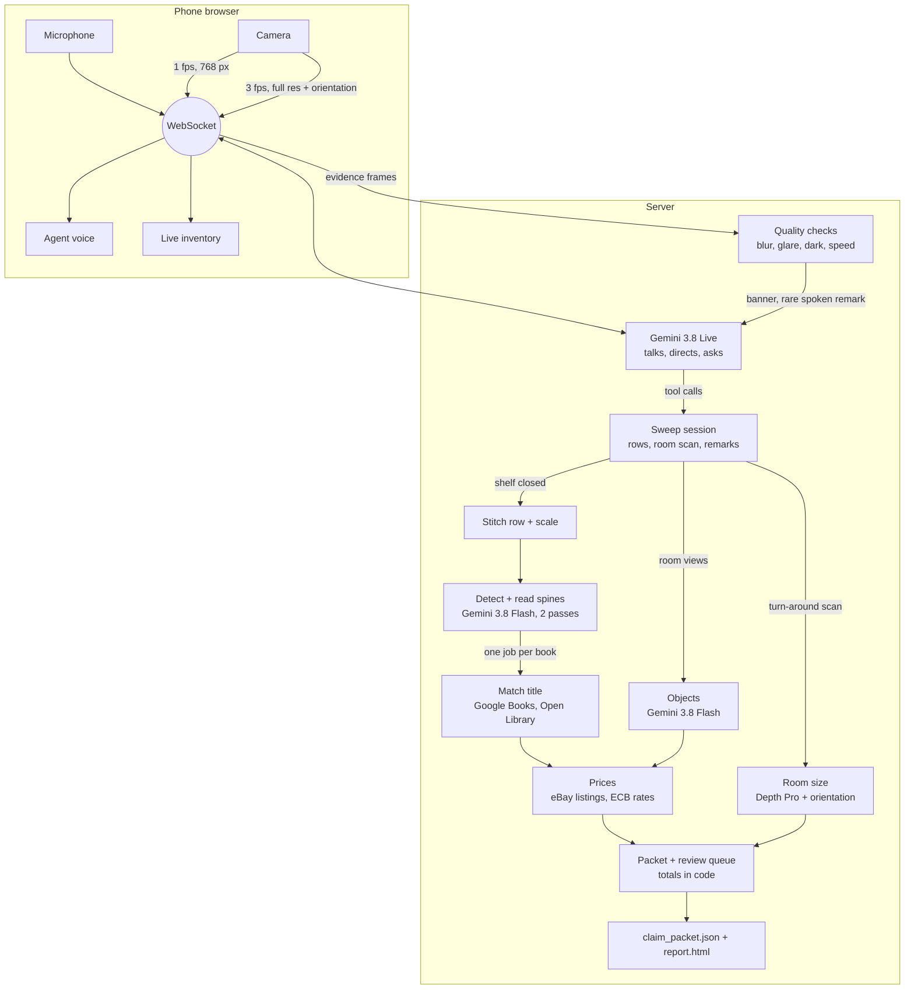

# Architecture

The language models read and talk. Code measures, counts, prices and adds up. Work starts the moment a
shelf is finished, so the packet is ready seconds after the sweep ends.

## Which model does what

| Model | Job | It never |
|---|---|---|
| Gemini 3.8 Live | Conversation: greets, confirms locale, names each shelf, asks for re-captures, asks "original or print?", reads the summary back | states a count, title, size or price that didn't come from a tool result |
| Gemini 3.8 Flash (low thinking) | Finds and reads every spine in overlapping tiles (two independent passes, unioned); finds room objects | names a book that isn't printed on the spine |
| Gemini 3.1 Pro | Second look at a spine read with low legibility | — |
| Depth Pro (local, pretrained) | Metric depth for the room scan and item sizes; shelf depth when no marker is visible | — |
| No model | Quality checks, scale, matching rules, appraisal rules, prices, conversion, totals, review queue | — |

## Where metric scale comes from

1. **Printed ArUco marker** (primary). Its four corners give a homography from pixels to centimetres on the
   shelf plane, so spine height, thickness and shelf run survive a tilted phone.
2. **No marker on a shelf:** Depth Pro measures every spine; identified books bring the published heights of
   their printed editions (Google Books); the scale is the one factor most books agree on within 4%. Set per
   shelf, because the depth model's scale error varied from -25% to +40% between images. Too few known heights:
   a typical book height, flagged approximate.
3. **Room:** a turn-around scan. Phone orientation (deviceorientation) plus Depth Pro place every pixel in one
   room frame; floor and ceiling are the extreme horizontal layers (from surface normals); walls are the far
   cluster in each direction. A marker seen during the turn or on a shelf corrects the depth scale.

## Where prices come from

eBay Browse API in the policyholder's marketplace: replacement = median of new fixed-price listings, used
value = median of used listings, found by ISBN first, then by title with lots, study guides and sequels
filtered out. Fewer than 3 matching listings means no price. A country without its own marketplace is priced
in the US market and converted at the ECB reference rate (Frankfurter), labelled converted. Every price keeps
its listing-search URL and retrieval time; the packet check removes any price without them. Rare, signed,
antiquarian-looking or over-threshold books and original art go to appraisal and are not priced.

## Stages and their outputs

Each stage is its own module with its own tests and writes its own output under `out/`: `quality`, `scale`,
`segment` (rows), `vision` + `boxes` (detections), `resolve` (matches), `pricing` + `fx`, `review`,
`room_scan`, `book_scale`, `packet` (evidence rules, totals), `report`. A sweep can be replayed through the
current code at no model cost; `evaluate` scores a packet against hand-collected ground truth.
